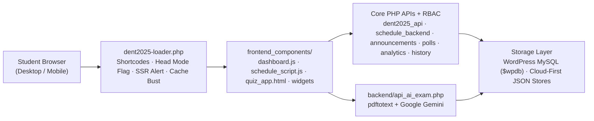
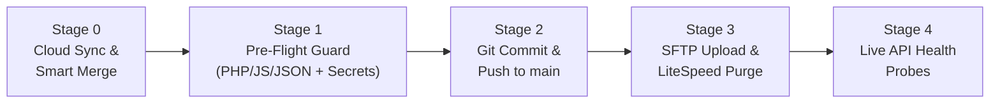

<div align="center">


# Dent2025 — Medical & Dental Academic Portal

**A high-performance academic hub for university Pre-Med, Medicine, and Dentistry students — built with a live dual-mode portal switcher, dynamic component loading, AI practice exams, interactive Hijri/Gregorian timelines, and automated SafeDeploy DevOps.**

[](https://dent2025.com)
[](LICENSE)
[](#architecture--codebase-structure)
[](#safedeploy-pipeline--devops)
[](#safedeploy-pipeline--devops)
[](#testing--validation)

[Dual Display Modes](#dual-portal-display-modes) ·
[Key Features](#key-features) ·
[Architecture](#architecture--codebase-structure) ·
[SafeDeploy](#safedeploy-pipeline--devops) ·
[Testing](#testing--validation) ·
[Local Setup](#local-setup--development)

</div>

---

## Dual Portal Display Modes

Dent2025 is architected with a **live, zero-downtime Master Mode Switch** (`multi_specialty_mode`) that lets administrators toggle the entire portal between a **single focused cohort** and a **full multi-specialty university hub** — instantly from the Admin Dashboard with no code edits or redeployment.

| Capability | Mode 1: Focused Cohort Mode (`OFF`) | Mode 2: Full Multi-Specialty Mode (`ON`) |
| :--- | :--- | :--- |
| **Scope Shown** | **Dentistry — Year 3, Semester 1 only** | **All 3 Specialties, All Years & All Semesters** |
| **Available Tracks** | Locked to `dentistry` · Year `3` · Semester `1` | **Pre-Med** (Y1 S1–S2) · **Medicine** (Y2–Y6 S1–S2) · **Dentistry** (Y2–Y6 S1–S2) |
| **Onboarding (`/wolcome/`)** | Bypassed — visitors are redirected directly to `/` | Active — first-time visitors pick Specialty, Year & Semester |
| **Student Context** | Automatically enforced in `localStorage` | Persisted per student in `localStorage` (`dent2025_selection`) |
| **Navbar Branding** | Dentistry identity by default | Instant pre-paint 2× retina logo swap per selected track |
| **Best Used For** | Streamlined, zero-click launch for the 3rd-year 1st-semester Dentistry batch | Full campus-wide academic portal spanning all colleges & levels |

<div align="center">

| <br/>**Pre-Med** | <br/>**Medicine** | <br/>**Dentistry** |
| :---: | :---: | :---: |
| Year 1 · Semesters 1 & 2 | Years 2–6 · Semesters 1 & 2 | Years 2–6 · Semesters 1 & 2 |

</div>

### How Mode Switching Works Under the Hood
- **Master Admin Toggle**: Authorized Master admins switch modes live from the top bar (desktop & mobile) in [`admin_dashboard.html`](admin_dashboard.html), calling `dent2025_api.php?action=save_portal_settings`. Every change is persisted in the WordPress option `dent2025_multi_specialty_mode` and recorded in the audit trail.
- **Zero-Flicker Hydration**: [`dent2025-loader.php`](dent2025-loader.php) injects `window.DENT_MULTI_SPECIALTY_MODE` synchronously into `<head>`, allowing [`dashboard.js`](frontend-html%20box%20in%20wordpress%20astra/dashboard.js) to resolve routing before first paint without an extra blocking network round-trip (with `sessionStorage` and `?action=portal_settings` fallback).

---

## Key Features

### ⚡ Dynamic Component Loader & Performance Engineering (`dent2025-loader.php`)
- **Shortcode-Driven Architecture**: WordPress pages mount local frontend modules via `[dent_component file="..."]` and `[dent_poll]` with strict filename sanitization against path traversal.
- **Automatic Cache-Busting**: Appends dynamic `?v={filemtime}` query strings to `.js`, `.css`, embedded assets, and lazy-loaded modules (`study_timer.js`, `dent_pin_modal.js`) so updates go live immediately.
- **Core Web Vitals Optimizations**:
  - **Zero Mobile CLS**: Server-side pre-rendering of tomorrow's calendar alert (`dent2025_prerender_tomorrow_alert`), reserved container heights, and explicit logo dimensions.
  - **Instant Navigation**: Speculation Rules API prerendering for core portal routes plus a lightweight hover/touch prefetcher for Safari & Firefox.
  - **Eliminated Render-Blocking Assets**: Inlined Astra base CSS (`main.min.css`), self-hosted WOFF2 fonts (*Outfit* & *Noto Kufi Arabic*), 2× retina `*-sm.webp` instant navbar logo swap, deferred non-critical scripts, and homepage LCP hero preloading.
- **Clean Quiz Short URLs**: Automatically routes `/quiz/<id>`, `/q/<id>`, `/?quiz=<id>`, and `/?q=<id>` to the interactive quiz player.

### 📅 Interactive Academic Schedule, Timetables & A4 Export
- **Dual Hijri & Gregorian Calendar**: Automated date conversion with instant filtering across Exams, Assignments, Practicals, Lectures, and Holidays.
- **Tomorrow Alert Banner**: Highlights upcoming next-day exams and academic deadlines (SSR-rendered for default cohort, dynamically updated client-side for all cohorts).
- **Printable A4 Schedule & Quiz Booklets**: High-fidelity multi-page A4 calendar table export in [`schedule_script.js`](frontend-html%20box%20in%20wordpress%20astra/schedule_script.js), paired with a headless Chrome batch A4 quiz booklet PDF exporter ([`tools/export_quiz_pdfs.js`](tools/export_quiz_pdfs.js)).
- **Class Timetable Manager**: Group-aware weekly schedules with per-event visibility controls.

### 🤖 AI Exam & Interactive Quiz Engine (`backend/api_ai_exam.php`)
- **PDF-to-Quiz Pipeline**: Extracts lecture content using `pdftotext` and generates structured practice exams via Google Gemini API with multi-key health rotation.
- **Dual Quiz Player Views**: Students can switch between a full-list exam view and a focused one-question-at-a-time study view inside [`quiz_app.html`](frontend-html%20box%20in%20wordpress%20astra/quiz_app.html).
- **Daily Cache Cron Sync**: Scheduled WordPress cron (`dent2025_daily_noon`, 12:00 PM AST) pre-warms AI exam caches for fast student load times.

### ⏱️ Student Productivity & Community Widgets
- **Sitewide Floating Study Timer**: Draggable, session-persistent tracker (`study_timer.js` + `study_timer_banner_widget.html`) with history logging via [`history_api.php`](history_api.php); lazy-loaded unless an active session is running.
- **Saudi 5.0 GPA Calculator**: Cumulative and semester GPA simulator with customizable credit weights and grade scales ([`gpa_calculator_elegant.txt`](frontend-html%20box%20in%20wordpress%20astra/gpa_calculator_elegant.txt)).
- **Jazan University Absence & Denial Calculator**: Tracks attendance against contact hours and alerts students approaching the 25% denial threshold ([`absence_calculator.html`](frontend-html%20box%20in%20wordpress%20astra/absence_calculator.html)).
- **Inline Student Polls & Community Cards**: Real-time polls (`[dent_poll]` backed by [`polls_api.php`](polls_api.php)), an interactive monochrome kinetic grid canvas (`kinetic_grid.html`), and a weekly community meme card (`weekly_meme.html`).

### 📊 First-Party Analytics & Unified RBAC Admin Suite
- **Privacy-First Visitor Telemetry**: Lightweight dwell-time and Verified Student Visits (VSV) tracking via [`analytics_api.php`](analytics_api.php), [`analytics_tracker.js`](frontend-html%20box%20in%20wordpress%20astra/analytics_tracker.js), and [`vsv_chart.html`](frontend-html%20box%20in%20wordpress%20astra/vsv_chart.html).
- **Unified Role-Based Access Control (`dent2025_rbac.php`)**: Supports Master administrators and context-scoped cohort leaders (e.g., `dentistry_3_1`, `pre-med_1_1`) with built-in authentication rate limiting.
- **Touch-Friendly 4-Digit PIN Modal**: Universal dark-mode numeric keypad (`dent_pin_modal.js`) for quick on-page admin unlocks.
- **Standalone Admin Dashboard (`admin_dashboard.html`)**: Manage subjects, Drive links, announcements, schedules, quizzes, polls, Dual-Mode portal switching, RBAC keys, and live **Unified Backup Systems Telemetry** without entering `wp-admin`.

---

## Architecture & Codebase Structure



```text
my website dent2025/
├── dent2025-loader.php                         # WordPress loader plugin ([dent_component], [dent_poll], perf, SSR)
├── dent2025_api.php                            # Primary WordPress-integrated API ($wpdb) & portal mode settings
├── dent2025_rbac.php                           # Shared RBAC authorization & rate-limiting engine
├── announcements_api.php                       # Cohort announcements & tasks API (JSON store)
├── schedule_backend.php                        # Academic timeline events API (JSON store)
├── polls_api.php                               # Inline student polls & voting API (JSON store)
├── analytics_api.php                           # First-party dwell-time & VSV telemetry API (JSON store)
├── history_api.php                             # Study timer logs, backup telemetry & audit history API
├── history_helpers.php                         # Shared snapshot & audit logging utilities
├── purge_cache.php                             # Standalone LiteSpeed cache purge diagnostic script
├── admin_dashboard.html                        # Standalone Admin Dashboard UI (includes Dual-Mode switch)
├── admin_app.js                                # Standalone Admin Dashboard client logic
├── backend/                                    # Standalone PDO & AI Exam module
│   ├── db_connect.php                          # PDO MySQL connection, CORS & JSON response helper
│   ├── api_ai_exam.php                         # Gemini AI exam generation, key rotation & cron sync
│   └── bin/                                    # CLI helper binaries (pdftotext)
├── frontend-html box in wordpress astra/       # Local frontend components (synced to /frontend_components/)
│   ├── dashboard.js                            # Core student dashboard & dual-mode routing engine
│   ├── landing_page.html                       # Multi-specialty track, year & semester selector (/wolcome/)
│   ├── chapters_dynamic.html                   # Subject chapters & Google Drive folder embed container
│   ├── quiz_app.html                           # Interactive quiz & AI practice exam player
│   ├── schedule_markup.html                    # Academic calendar timeline layout & stat cards
│   ├── schedule_script.js                      # Hijri/Gregorian timeline engine & A4 PDF exporter
│   ├── calendar_tomorrow_alert.html            # Tomorrow's exam/event banner (SSR + client refresh)
│   ├── study_timer_banner_widget.html          # Floating study timer banner & modal markup
│   ├── study_timer.js                          # Lazy-loaded study timer & session tracker engine
│   ├── poll_widget.html                        # Inline student poll component ([dent_poll])
│   ├── vsv_chart.html                          # Verified Student Visits historical chart
│   ├── analytics_tracker.js                    # Lightweight first-party dwell-time tracker
│   ├── kinetic_grid.html                       # Interactive monochrome kinetic grid background canvas
│   ├── gpa_calculator_elegant.txt              # Saudi 5.0 scale GPA calculator widget
│   ├── absence_calculator.html                 # Jazan University Absence & Denial calculator
│   ├── weekly_meme.html                        # Weekly community meme card component
│   ├── dent_pin_modal.js                       # Touch-friendly 4-digit admin PIN keypad
│   ├── admin_*.html                            # On-page admin lock & modal controls
│   └── fonts/                                  # Self-hosted WOFF2 fonts (Outfit & Noto Kufi Arabic)
├── tools/                                      # SafeDeploy pipeline, sync & offline test toolchain
│   ├── deploy_safe.py                          # Full 5-stage Git-integrated SafeDeploy CLI
│   ├── deploy.py                               # SFTP & OpenSSH SCP uploader / rollback engine
│   ├── deploy_guard.py                         # Pre-flight PHP/JS/JSON syntax & secret guard
│   ├── deploy_health.py                        # Post-deployment live API health probes
│   ├── deploy_order.py                         # Dependency-aware file deployment ordering
│   ├── sync_cloud_events.py                    # Cloud-first dynamic data pull & smart-merge engine
│   ├── sync_server_backups.py                  # Off-server rolling backup mirror (14-day retention)
│   ├── export_quiz_pdfs.js                     # Headless Chrome batch A4 quiz PDF booklet exporter
│   ├── test_system_logic.php                   # Offline test suite (100/100 assertions across 12 modules)
│   └── _toolkit.py                             # Shared workspace bootstrap helper
├── logos/                                      # Specialty icons (full + 2× retina *-sm.webp) & OG banner
└── docs/                                       # Architecture & deployment specifications
    ├── DEPLOYMENT_GUIDE.md                     # Detailed SafeDeploy & server configuration guide
    └── MAIN_PAGE_DESIGN_SPEC.md                # Homepage UX/UI layout specifications
```

---

## SafeDeploy Pipeline & DevOps

All live website updates flow through **SafeDeploy**, a 5-stage automated pipeline that protects cloud data, validates syntax, commits to Git, uploads in 1–2 seconds, purges caches, and verifies production health:



### Common Commands

```bash
# Deploy modified files with automatic cloud merge, syntax check, Git commit, upload & cache purge
python tools/deploy_safe.py --note "Refine calendar table layout" "frontend-html box in wordpress astra/schedule_script.js"

# Dry run (validate syntax, cloud state, and routing without deploying)
python tools/deploy_safe.py --dry-run --note "Verify API changes" "dent2025_api.php"

# Instant one-command rollback (reverts Git HEAD, redeploys clean state & purges cache)
python tools/deploy_safe.py --rollback

# Inspect Git status, recent deploys, and live server health
python tools/deploy_safe.py --status

# Run standalone live endpoint health check
python tools/deploy_safe.py --health-check
```

---

## Cloud-First Data Integrity & Multi-Tier Backups

- **Cloud-First Source of Truth**: The live Azure server (`/var/www/dent2025/`) is authoritative for dynamic runtime data (`schedule_events*.json`, `announcements_data/`, `dent2025_classes.json`). Stage 0 automatically smart-merges cloud updates and blocks accidental deletions unless `--allow-delete` is explicitly passed after snapshotting.
- **Server-Side Guardrails (`safe-rm`)**: Mechanically blocks destructive recursive deletions across web root and system paths on the VPS.
- **Automated Nightly VPS Backups**: Cron runs nightly at `03:30 UTC`, producing compressed MySQL dumps (`db_wordpress_*.sql.gz`) and dynamic data archives (`data_*.tar.gz`) with a rolling 14-day retention policy.
- **Off-Server Local Mirror & Live Telemetry**: Daily Windows Task Scheduler runs `tools/sync_server_backups.py` to mirror VPS archives locally, while `admin_dashboard.html` reports real-time status across all backup layers and live SafeDeploy commits.

---

## Testing & Validation

Run the zero-dependency offline test suite to verify RBAC authorization, Pre-Med/cohort normalization, rate limiting, passkey sanitization, response contracts, and edge cases across **12 subsystems**:

```bash
php tools/test_system_logic.php
# Expected: Passed 100 / 100 — ALL SUBSYSTEM LOGIC CHECKS PASSED PERFECTLY!
```

---

## Local Setup & Development

### 1. Prerequisites
- **PHP 8.2+** with `pdo_mysql`, `curl`, and `json` extensions enabled.
- **Python 3.9+** with `paramiko` installed (`pip install paramiko`) for SafeDeploy automation.
- **Node.js 18+** (optional, used by `deploy_guard.py` for JS syntax validation and `tools/export_quiz_pdfs.js` for PDF booklet generation).
- **Git** configured with SSH authentication.

### 2. Configuration
Copy the example templates into local gitignored config files:

```bash
cp deploy_config.example.json deploy_config.json
cp dent2025_passwords.example.json dent2025_passwords.json
```

- **`deploy_config.json`**: Set your SFTP/SSH host, port, credentials, and remote web root (`/var/www/dent2025/`).
- **`dent2025_passwords.json`**: Configure Master and cohort-leader RBAC passkeys and granular permissions.

---

## Additional Documentation

- [Deployment Guide](docs/DEPLOYMENT_GUIDE.md) — SafeDeploy stages, server routing rules, and recovery playbooks.
- [Main Page Design Spec](docs/MAIN_PAGE_DESIGN_SPEC.md) — Homepage UI/UX layout and styling guidelines.
- [Architecture & Agent Guidelines](AGENTS.md) — Comprehensive system architecture reference.

---

## License

This project is open-source and licensed under the [MIT License](LICENSE).
